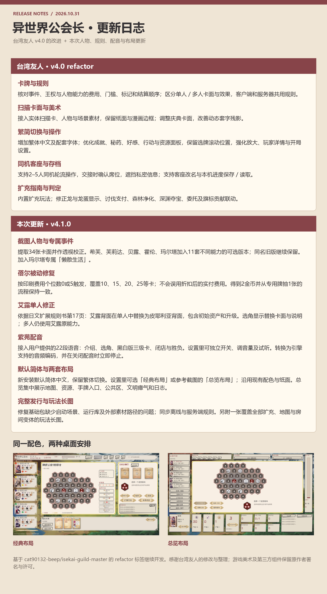
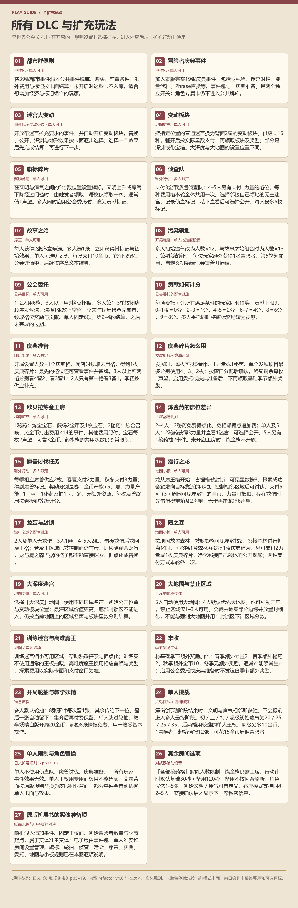

# 异世界公会长 4.1.0

基于台湾友人 [cat90132-beep 的 refactor v4.0 发布版](https://github.com/cat90132-beep/isekai-guild-master/releases/tag/refactor)继续更新，保留扫描卡面、繁简切换、同机客座、交接确认、本机存读档、扩充规则与操作改进。上游完整说明见 [UPSTREAM_README](docs/UPSTREAM_README.md)。

从 [v4.1.0 发行页](https://github.com/shuiwen879867/isekai-guild-master/releases/tag/v4.1.0) 下载 `GuildMaster-Windows-4.1.0.zip`，完整解压后运行 `GuildMaster.exe`。Windows 10/11 64位，无需另装 Godot、Python 或 Ren’Py。



## 本次修改

- 提取截图中的34张卡面，接入希芙、芙莉达、贝露、霍伦、玛尔塔的11套能力版本和专属事件“懒散生活”；不同能力保留为不同选项，原版角色仍可选择。
- 蓓尔白版按**印刷费用个位数0或5**触发，覆盖10、15、20等费用，不使用折扣后的实付金币。
- 按日文《拡張ルールブック》第17页，单人选择艾露背面时改用**皮耶利亚背面**，包括初始资产、常驻能力与升级；选角显示替换说明。
- 接入用户提供的紫苑（原界面名“诗音”，Shion）22段配音。设置中可独立开关、调节音量和试听；没有样例的角色不会播放紫苑语音。
- 新安装默认简体中文，保留繁体切换。设置可选择经典或总览两种桌面布局，沿用原配色。
- 补齐启动场景、完整离线运行库及外部素材路径；客户端、服务器与回放资源同步更新。

## 所有 DLC 与扩充玩法



## 联机与部署

默认游戏服务器 `guanpeng666.cn:6677`；回放为 `http://guanpeng666.cn:6767`，介绍与两张长图在 `http://guanpeng666.cn:6680`。4.1客户端与服务端需一起更新。只更新源码不会改变已经运行的服务。

服务器下载 `guild-server-4.1.0.zip`，或直接使用仓库 `guild-server/`。仅需 Python 3.9以上及标准库；保留自己的 `server_config.json`、`replays/`，在没有进行中对局时停止旧服务，替换程序及网页后重启：

```sh
python3 server.py --host 0.0.0.0 --port 6677 --web-port 6767 --site-port 6680
```

## 从源代码运行

客户端源码在 `GuildMaster-Godot-src/`，使用 Godot 4.7.2。将 `GuildMaster-Godot/` 下 `art/`、`rules/`、`runtime/` 复制至源码目录，可按 F5 运行。规则源文件以 `guild-server/` 为准，`python tools/prepare_update.py` 同步到离线客户端。

构建：`python tools/build_update_release.py`，输出在 `dist/`。可通过 `GODOT_BIN` 指定Godot控制台程序；导出模板在Godot中安装或填写 `export_presets.cfg`。GitHub源码不包含exe与Python标准库zip，首次构建需从完整客户端包复制 `runtime/`，或使用官方Python 3.13嵌入式运行库。

验证：`python -m unittest discover -s tests -v`。`GuildMaster-Godot-src/tools/update_qa.gd` 检查新卡面、配音开关、默认语言与2/5人布局。上游规则回归脚本保留在 `GuildMaster-Godot/tools/`。

## 来源与许可

台湾友人的改动保留署名与原始说明。新卡面及配音由用户提供，原始ZIP与截图不被修改；提取坐标与校验值见 `docs/SUPPLIED_ASSETS.json`。日文规则书用于核对，未重复加入发行包。游戏美术、字体、Godot和Python的许可见包内 `LICENSES/` 与 `runtime/LICENSE.txt`。
